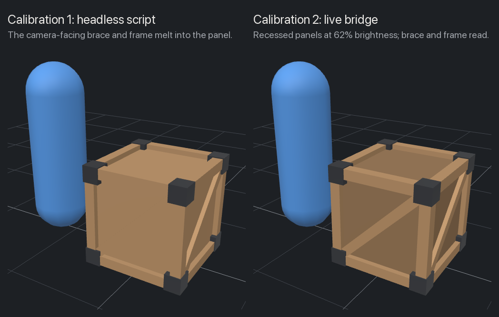

# Calibration 2: Crate_01 through the live Blender bridge

Run on 2026-11-06 for [issue #2](https://github.com/imDev2023/x-gaming/issues/2): the same brief as [calibration 1](../2026-11-05-crate/README.md), this time driven through [MCP for Blender](https://github.com/ahujasid/mcp-for-blender) in a live Blender, with its `look` tool for the look step.
No paid calls were made.

## Verdict

Use the bridge to author props, and keep its final calls as committed scripts.
Looking live, from any angle, distance and shading, caught two defects that calibration 1's fixed renders and number checks missed, and one of them had shipped in calibration 1.
The cost is safe mode's script discipline: every call is a self-contained script.
That discipline pays back, because the three calls that made the asset rerun headless and give a byte-identical GLB, so the record and any CI do not need the GUI.

## What ran

- **Bridge:** MCP for Blender 2.2.7 (add-on 1.8, protocol 15) with `BLENDER_MCP_SAFE_MODE=1` and `DISABLE_TELEMETRY=true`, in Blender 4.3.0.
  Every asset library and generator was off, and telemetry consent read `false`.
- **Launch:** Blender's GUI with the add-on enabled for this run only, leaving the owner's preferences unchanged:

  ```bash
  BLENDERMCP_NO_UPDATE_CHECK=1 /Applications/Blender.app/Contents/MacOS/Blender --addons blender_mcp
  ```

  The add-on starts its server by itself (its auto-start setting defaults to on) and bound to `127.0.0.1:9876` only.
  `BLENDERMCP_NO_UPDATE_CHECK=1` skips its startup check against GitHub, since the add-on was already checked against the reviewed package.
- **Brief:** [../2026-11-05-crate/brief.md](../2026-11-05-crate/brief.md), unchanged.
  The build reuses calibration 1's approved design (frame, inset body, braces, proud caps), so the comparison is between methods, not designs.
- **Calls:** [build.py](build.py), [checks.py](checks.py) and [export.py](export.py), each sent whole through `execute_blender_code`; `export.py` was sent with `{checkout}` replaced by the local checkout's path.
  Raw output of the checks: [blender-report.json](blender-report.json).
- **Validation:** `npx @gltf-transform/cli@4.5.1 validate crate_01.glb` and `inspect`.
- **Engine check:** calibration 1's [viewer.html](../2026-11-05-crate/viewer.html), which now takes `?src=`, opened as `viewer.html?src=../2026-11-06-crate-bridge/crate_01.glb` from a local server at the `calibration/` folder.

To rebuild without the bridge, from this folder:

```bash
sed "s|{checkout}|$(git rev-parse --show-toplevel)|" export.py > "$TMPDIR/export.py"
/Applications/Blender.app/Contents/MacOS/Blender -b --factory-startup \
  --python build.py --python checks.py --python "$TMPDIR/export.py"
```

## Result

Every done check passes.

| Check | Result |
| --- | --- |
| Bounds | 1.000 x 1.000 x 1.000 m in Blender and in Three.js |
| Triangles | 300 of a 500 budget |
| Origin | bottom center; minimum Y is 0 and X, Z are centered in the engine |
| Transforms | none to apply: the mesh is built in world space around the origin |
| Names | object and mesh `Crate_01`, materials `Wood_A` and `Metal_A`, UV map `UVMap`, color attribute `Col`; no `.001` after six rebuilds in one session |
| Materials | both used (102 and 48 faces), single-sided, no textures |
| Coplanar faces | 0 same-facing overlaps, now checked by script, and the check's self-test passes |
| Validation | 0 errors, 0 warnings; 2 infos for unused UVs, kept for later texturing |
| File | 30 KB GLB; calibration 1's was 23 KB, and the difference is the color attribute |
| Look | multi-angle bridge looks reviewed by the agent during the session: [look-sheet.png](look-sheet.png) |
| Engine | loads at the right scale, origin and orientation, and the braces read face-on: [engine-check.png](engine-check.png), [engine-compare.png](engine-compare.png) |
| Reproducible | the committed calls rerun headless give a byte-identical GLB and an identical report |



## What the live look caught

1. **The braces vanished face-on.**
   A brace's front face has the same material and normal as the panel behind it, so under flat lighting they draw as one color, and the frame melts into the panel too.
   The first solid look after adding the braces showed no brace at all on the front, right and back views.
   Calibration 1 shipped with this defect: its Workbench renders turned on cavity shading and outlines, which draw edges a game engine never draws, and its engine check showed a featureless camera-facing side that no check asked about.
   Fix: a `Col` color attribute darkens the recessed body panels to 62% brightness, a hand-baked stand-in for ambient occlusion.
   It exports as glTF `COLOR_0`, which Three.js multiplies into the base color by itself, and it costs no triangles, no textures and no extra material.
2. **The metal caps came out as wood.**
   `mesh.materials.clear()` after `bmesh.to_mesh()` reset every face's material index to 0, so all 150 faces used `Wood_A`.
   The look showed brown caps at once.
   Calibration 1's materials check compared slot names only and would have passed this; calibration 1 itself was not affected, because it assigned materials to each part before joining.
   Fix: set the slots before `to_mesh()`, and check that every material is used by at least one face.
3. **Printing state, not the look, caught a stray name.**
   `bmesh`'s `loops.layers.uv.verify()` named the UV map `Float2`; the build now names it `UVMap`, and the names check covers UV maps and color attributes.

The coplanar check, done by eye in calibration 1, is now a script: it flags pairs of faces that share a plane, face the same way and overlap by more than 1 mm².
Its self-test flags calibration 1's first build (caps flush with the beams, 2 overlaps) and passes the fix (caps 1 cm proud, 0 overlaps).
It also counts 20 back-to-back pairs, the 16 rail ends against the posts and the 4 brace backs against the body: hidden contact faces that cannot flicker with backface culling on, about 40 triangles that could go if the budget ever gets tight.

## Bridge against script

| | Calibration 1: headless script | Calibration 2: live bridge |
| --- | --- | --- |
| Loop | edit the script, rerun Blender, open the PNGs | small calls into one open Blender, look whenever needed |
| Look | 8 fixed renders: 4 Workbench angles with cavity and outlines, solid and wireframe | 13 looks chosen on the spot: solid, wireframe, Material Preview and EEVEE, close and at the brief's 4 m |
| Defects found by looking | z-fighting caps, shallow braces | vanishing braces (missed in calibration 1), all-wood caps |
| Time | not recorded | 52 s from launch to a listening bridge; 7 min 42 s from the first build call to a checked export, with 6 builds, 3 safe-mode rejections and 13 looks |
| Needs | Blender, headless | Blender's GUI and an MCP session started after the install |
| Record | the script | the same calls as committed scripts, rerunnable headless |

### What safe mode blocked

Safe mode checks each script's syntax tree before it reaches Blender.
It never blocked the work itself: building, looking, rendering, saving the `.blend` and exporting the GLB are all allowed.
It rejected three scripts, one of them a deliberate probe:

- `import time`: only `bpy`, `bmesh`, `mathutils` and pure-Python standard modules may be imported.
- The probe, reading a name defined in an earlier call: every name must be bound in the same script, so nothing carries over between calls and state lives only in `bpy.data`.
- A `lambda`: it hides the real call target, so plain functions and loops only.

`open()` is blocked as well, so the check report is printed and saved from the tool's output rather than written by Blender.
The guard covers only the MCP path; the add-on's socket would accept raw code from any local process, which is why it must stay on localhost.

### Other friction

- The build had to be one idempotent script resent whole on every call, 100 to 130 lines each time; reusing materials, mesh and object by name kept reruns free of `.001` duplicates.
- The first Material Preview look after changing material nodes came back grey while EEVEE compiled shaders; a second look a moment later was correct.
- Material and rendered angle looks frame the object smaller than solid ones; passing `distance` fixes it.
- In EEVEE rendered looks the startup file's single point light leaves the front face black, so Material Preview's studio lighting is the better stand-in for a game scene.
- The exporter's `export_format` enum reads empty through `bl_rna`, so the bridge's advice to read enum identifiers rather than hardcode them does not work there; `GLB` is the documented value.
- The GUI also loads the owner's other add-ons: BlenderKit logged connection errors and ran its updater during startup.
- Each `look` image is also saved as a PNG in the session's tool-results folder, which is how the look sheet was assembled from the real bridge views.

## Files

- [build.py](build.py), [checks.py](checks.py), [export.py](export.py): the three calls that made and checked the asset.
- [crate_01.glb](crate_01.glb): the exported prop.
- [blender-report.json](blender-report.json): the check report.
- [look-sheet.png](look-sheet.png): what the live look caught, then the final shape and material.
- [engine-check.png](engine-check.png) and [engine-compare.png](engine-compare.png): the Three.js check, alone and next to calibration 1 under the same camera and lights.
