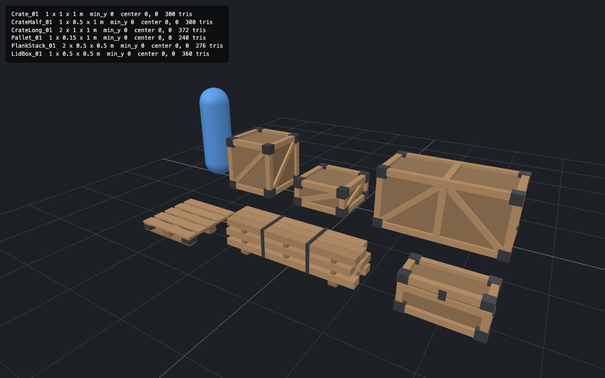
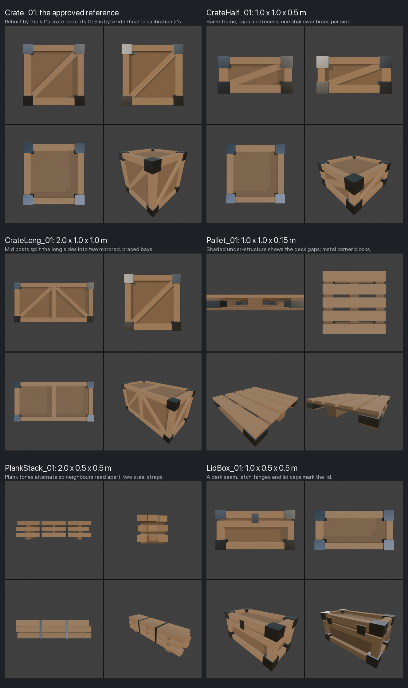
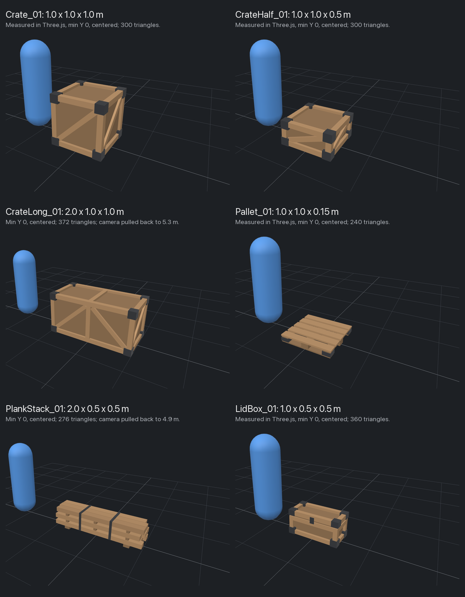

# Calibration 3: a six-piece kit in Crate_01's style

Run on 2026-11-06 for [issue #3](https://github.com/imDev2023/x-gaming/issues/3): Crate_01 and five new pieces, built, looked at, checked and exported through [MCP for Blender](https://github.com/ahujasid/mcp-for-blender) in a live Blender, following WORKFLOW.md's rule to approve one piece and then ask for variants in the same style and grid.
No paid calls were made.

## Verdict

The approve-one-then-variants rule works, once the approved piece's build is turned into a function of its size before any variant is made.
Five new pieces went from the first build call to checked, exported GLBs in about 5.5 minutes, with one defect, and the rebuilt Crate_01 came out byte-identical to calibration 2's, which proves the shared code kept the approved look.
The one defect, lid caps sharing the lid's underside plane, showed in no look and was caught only by the scripted coplanar check, so the checks now run after every build, not only before export.



## What ran

- **Style and pieces:** the owner approved Crate_01's look as the kit's style, including the recessed panels at 62% brightness, and chose the five proposed pieces; both answers are recorded on the issue.
- **Briefs:** [briefs.md](briefs.md), one per piece from the workflow's template; Crate_01 keeps [its own](../2026-11-05-crate/brief.md).
- **Bridge:** MCP for Blender 2.2.7 (add-on 1.8, protocol 15) with safe mode on and telemetry off, in Blender 4.3.0, launched with the workflow's command; every asset library and generator was off.
- **Calls:** [build.py](build.py), [checks.py](checks.py) and [export.py](export.py), each sent whole through `execute_blender_code`, with [show.py](show.py) between looks; `export.py` was sent with `{checkout}` replaced by the local checkout's path.
  Raw output of the checks: [blender-report.json](blender-report.json).
- **Validation:** `npx @gltf-transform/cli@4.5.1 validate` and `inspect` on each GLB.
- **Engine check:** calibration 1's [viewer.html](../2026-11-05-crate/viewer.html), opened from a local server at the `calibration/` folder, once per piece as `viewer.html?src=../2026-11-06-kit/<file>.glb` and once with all six `src` values for the lineup above.

### How the build is organised

[build.py](build.py) holds the kit in one self-contained script, as safe mode requires.
Crate_01's construction became `crate(sx, sy, sz, ...)`: a recessed body, 12 edge beams, a brace per bay and metal corner caps, at any size.
Crate_01, CrateHalf_01 and CrateLong_01 are three calls to it, and LidBox_01 uses it for its body without braces or top caps.
Pallet_01 and PlankStack_01 have their own functions built from the same `box()` helper, the same two materials and the same two rules: recessed or shadowed wood is shaded at 62%, and metal stands 1 cm proud of the wood it covers.
Every piece sits at the origin with no transforms, so [show.py](show.py) hides the others while one is looked at, and [export.py](export.py) unhides and selects each piece in turn.

To rebuild without the bridge, from this folder:

```bash
sed "s|{checkout}|$(git rev-parse --show-toplevel)|" export.py > "$TMPDIR/export.py"
/Applications/Blender.app/Contents/MacOS/Blender -b --factory-startup \
  --python build.py --python checks.py --python "$TMPDIR/export.py"
```

## Result

Every done check passes for every piece.

| Piece | Size (m) | Triangles | Faces wood / metal | GLB | What broke |
| --- | --- | --- | --- | --- | --- |
| Crate_01 | 1.0 x 1.0 x 1.0 | 300 | 102 / 48 | 29.8 KB | Nothing; byte-identical to [calibration 2's](../2026-11-06-crate-bridge/crate_01.glb) |
| CrateHalf_01 | 1.0 x 1.0 x 0.5 | 300 | 102 / 48 | 29.8 KB | Nothing; the braces lie at 20 degrees and still read face-on |
| CrateLong_01 | 2.0 x 1.0 x 1.0 | 372 | 138 / 48 | 36.4 KB | Nothing in the model; the check page hid its stand-in player behind the crate (fixed in the page) |
| Pallet_01 | 1.0 x 1.0 x 0.15 | 240 | 96 / 24 | 24.2 KB | Nothing |
| PlankStack_01 | 2.0 x 0.5 x 0.5 | 276 | 102 / 36 | 27.6 KB | Nothing; plank tones were planned in so neighbouring planks read apart |
| LidBox_01 | 1.0 x 0.5 x 0.5 | 360 | 114 / 66 | 35.3 KB | Lid caps flush with the lid's underside: 12 same-facing coplanar pairs, caught by `checks.py` |

Sizes are width x depth x height, as in the briefs.

| Check | Result |
| --- | --- |
| Bounds | match each brief exactly, to 0.1 mm in Blender and to 1 mm in Three.js |
| Grid | every footprint is a multiple of 0.5 m |
| Origin | bottom center for every piece; minimum Y is 0 and X, Z are centered in the engine |
| Transforms | none to apply: every mesh is built in world space around the origin |
| Names | objects and meshes as briefed, materials `Wood_A` and `Metal_A` shared by all six, UV map `UVMap`, color attribute `Col`; no `.001` |
| Materials | both used by every piece, single-sided, no textures |
| Coplanar faces | 0 same-facing overlaps in every piece after the fix, and the check's self-test passes |
| Validation | 0 errors and 0 warnings for every GLB; 2 infos each for unused UVs, kept for later texturing |
| Look | multi-angle Material Preview and wireframe looks of each piece, reviewed by the agent, and the kit approved by the owner on 2026-11-06: [look-sheet.png](look-sheet.png) |
| Engine | each loads at the right scale, origin and orientation, and its details read face-on: [engine-check.png](engine-check.png), [engine-lineup.png](engine-lineup.png) |
| Reproducible | the committed calls rerun headless give six byte-identical GLBs and the same check results |





## What the checks and looks caught

1. **The lid caps shared the lid's underside plane.**
   The caps covered the lid's corners from its underside to 1 cm above its rim, so their bottom faces lay in the lid's bottom plane and overlapped the rim and lid panel there: 12 same-facing pairs that would flicker wherever the underside shows.
   No look showed it, because the faces point down, under the lid; `checks.py` failed the piece, and a one-off call listed the face pairs.
   Fix: the caps stand 1 cm proud on every face, the underside too, as the style rule already said.
2. **The materials check counted a material the kit does not use.**
   The GUI session's file holds an unused grease-pencil material, `Dots Stroke`, so a check of everything in `bpy.data.materials` failed.
   Fix: the kit check compares the materials the pieces use, which is also what the GLBs contain.
3. **The check page hid the player behind wide models.**
   It placed the stand-in player at x = -1.2 m, right for a 1 m crate, but the 2 m crate covered it in perspective, and moving the player out put it under the report panel.
   Fix in [viewer.html](../2026-11-05-crate/viewer.html): the player stands further out beside wide models, and the camera keeps the original 4 m view unless the scene would leave the screen or fall under the panel, in which case it pulls back along the same direction.
   The page also takes several `src` values and lays them out in rows on the grid, for a kit lineup.
   It still renders calibration 2's check pixel for pixel; calibration 1's committed screenshot differs only inside the report panel, which gained its file-name line in calibration 2.

Planned in from calibration 2's lesson, and confirmed by the looks: the pallet's under-structure is shaded at 62%, so the gaps between deck boards read from above, and the planks alternate between three tones, so neighbouring planks, which share a material and a facing, do not merge face-on.

## Bridge notes

- 14 s from launch to a listening bridge; calibration 2 took 52 s.
- The first status call failed with a broken pipe, the MCP server's connection to an earlier Blender; a second call connected.
- 2 builds, 3 check runs (one of them the face-pair listing) and 22 looks: 9 before the export, 7 retaken for even framing on the look sheet, and 6 wireframe.
- Safe mode rejected nothing: writing every call to WORKFLOW.md's script rules from the start avoided calibration 2's 3 rejections.
- The first Material Preview look after each build came back partly grey while EEVEE compiled shaders; a second look was correct.
- Wireframe looks frame much tighter than Material Preview looks at the same `distance`, so they were left to frame themselves.

## Files

- [briefs.md](briefs.md): one brief per new piece.
- [build.py](build.py), [checks.py](checks.py), [export.py](export.py): the three calls that made, checked and exported the kit; [show.py](show.py) isolates one piece for a look.
- [crate_01.glb](crate_01.glb), [crate_half_01.glb](crate_half_01.glb), [crate_long_01.glb](crate_long_01.glb), [pallet_01.glb](pallet_01.glb), [plank_stack_01.glb](plank_stack_01.glb), [lid_box_01.glb](lid_box_01.glb): the kit, 183 KB in all before compression.
- [blender-report.json](blender-report.json): the check report.
- [look-sheet.png](look-sheet.png): the bridge looks of each piece.
- [engine-check.png](engine-check.png) and [engine-lineup.png](engine-lineup.png): the Three.js check, piece by piece and as a lineup.
