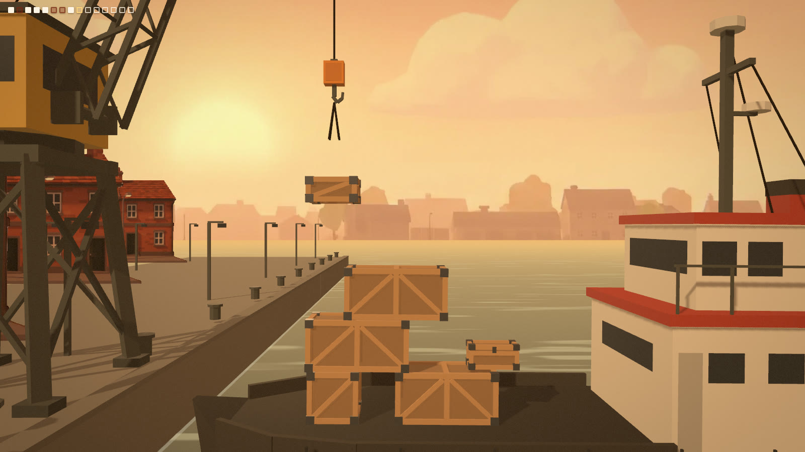
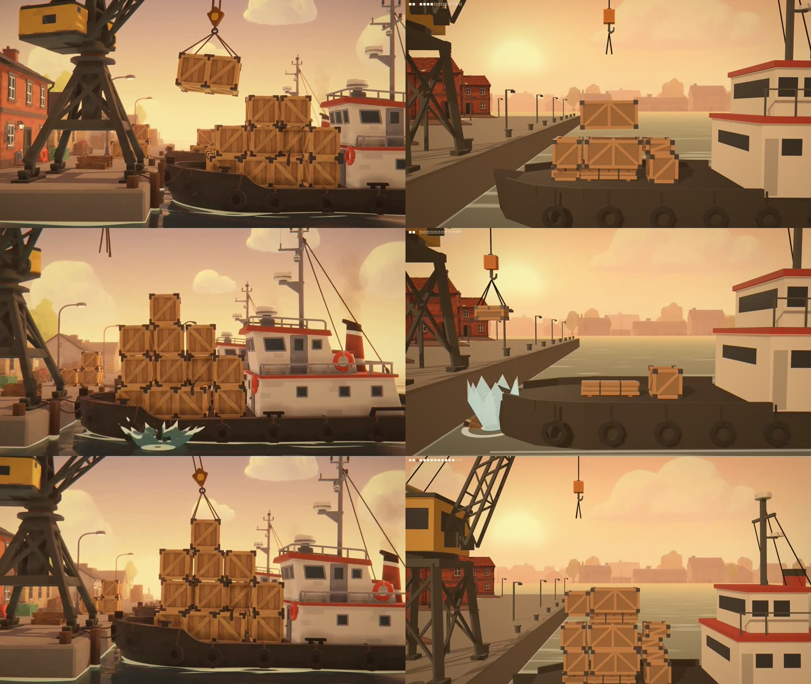
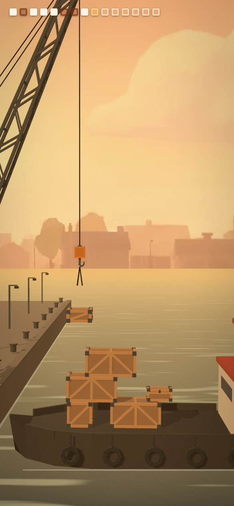

# Calibration 4: Dockstack, a one-level game through the Video2Game skill

Run on 2026-11-06 for [issue #1](https://github.com/imDev2023/x-gaming/issues/1).
The operator chose the concept, Dockstack (verb: stack; on-chain hook: a daily seeded challenge whose scores a server checks by replaying each run), and approved up to 10 USD of fal calls; both answers are on the issue.
The [Video2Game](https://github.com/lovisdotio/video-to-game) workflow ran once end to end: concept video, spec from frames, assets, game, look match and playtest, followed by WORKFLOW.md's Blender asset loop and ship check.
It spent 2.67 USD of fal calls.



## Verdict

Video2Game works for us, and costs less than its gallery average once our free sources cover the 3D.
One 10 s take of the concept video was enough, and the Crate_01 kit plus five agent-built Blender pieces replaced every image-to-3D call, so fal only paid for the video, two backdrop images, eight sounds and one music track.
That came to 2.67 USD, against a gallery median of 6.13 USD that also leaves out the video.

Matching the video's look was the hard part, and the skill's side-by-side routine is what found the problems.
The first build was a flat side view from 15 m that missed the video's close, wide lens, its front light and its receding quay, and only the paired frames showed it.

The on-chain hook is feasible as designed.
The simulation runs in integers only, and a run played in Chrome replays from its seed and 15 release ticks to the same score and state hash in the page, in Node (V8) and in JavaScriptCore.

Open before anything of value rides on it: the generated images and sounds' commercial terms, the wallet and contract work, a test in Firefox's engine, a human playtest and a real phone.

## What ran

| Step | What happened |
| --- | --- |
| Concept and spend | Asked on the issue; the operator picked Dockstack from three concepts and approved up to 10 USD. |
| Video | One take on fal with `minimax/h3-max/text-to-video`, 10 s at 1080p, seed 101, prompt expansion off; it came back as 10.14 s with no cuts, in 57 s. The prompt is in [SPEC.md](SPEC.md). |
| Spec | The skill's `study_video.py` saved a frame every 0.5 s and a [contact sheet](study/sheet.jpg); [SPEC.md](SPEC.md) gives the camera, the mechanic, the key moment, the world, a palette measured from the frames, and the game design. |
| Free assets | The six-piece [crate kit](../2026-11-06-kit/README.md) and five new pieces built through MCP for Blender: [briefs](blender/briefs.md), [build.py](blender/build.py), [checks.py](blender/checks.py), [export.py](blender/export.py), [report](blender/blender-report.json). |
| Paid assets | A sky plate and a brick terrace (`fal-ai/nano-banana-pro/edit` from the video's frames), the terrace's cutout (`fal-ai/birefnet/v2`), eight sounds (`fal-ai/elevenlabs/sound-effects/v2`) and one minute of music (`elevenlabs/music/v2.5`); every call is in [fal-log.json](fal-log.json). |
| Game | [game/index.html](game/index.html) on Three.js r170, started from the skill's template, with the rules in [game/sim.js](game/sim.js) and 12 tests in [game/sim.test.mjs](game/sim.test.mjs). |
| Look match | Three side-by-side pairs at the same three spots (a crate over the stack, the splash, a tall stack), over three rounds of fixes. |
| Playtest | [play.mjs](play.mjs) plays with the Space key only, reading `window.__game.state`; the skill's `record_play.mjs` filmed three takes and `best_window.py` ranked them. |
| Ship check | Load size, meshopt compression, phone and ultrawide viewports, frame rate, console errors. |

The skill was used from a clone of `lovisdotio/video-to-game` at commit `d1a24fd` (2026-10-28), with its scripts run from outside the clone.
The Claude Code plugin was not installed, because a newly installed skill only loads in a later session; its instructions and scripts are the same files.

## The game

Play it at [dockstack.vercel.app](https://dockstack.vercel.app/), live since 2026-11-07 on the owner's Vercel account.
The game's code now lives in its own public repo, [imDev2023/dockstack](https://github.com/imDev2023/dockstack), which deploys the live site; the `game/` folder here is this calibration's record as of commit `f359a18` and is no longer deployed.
The page explains the rules before the first drop, keeps each player's best score for the day in their own browser, and offers a Share on X button with the result; there is no sign-in and no shared leaderboard yet.

Tap, click or press Space to drop the crate from the crane's hook onto the boat; gamepad A works too.
The hook sweeps the deck faster with each crate, and the boat surges and heaves on the swell, so the target moves under the hook.
A crate rests if its centre lies over what it lands on; otherwise it tips off and is lost, and one dropped past the bow falls between quay and hull with a splash, the video's key moment.
A shipment is 15 crates of five shapes from the kit, counted by the squares in the top-left corner; when the last one is down, the boat sounds its horn and sails off, and the score is crates loaded, then the stack's height.
A run takes about 40 s.

To play and test it locally:

```bash
cd calibration/2026-11-06-video2game/game
python3 -m http.server 8000      # then open http://127.0.0.1:8000/
node --test .                    # the simulation's tests
./build.sh                       # recompress the models from their sources
```

To publish it, `./deploy.sh` stages the site in `game/dist/` (gitignored) with Three.js served from the site itself and the link-card tags for X, and `./deploy.sh --prod` also deploys that folder to Vercel production.
Set `SITE` if the address ever changes, since X reads the card image from it.

URL parameters: `?seed=N` (default: today's UTC date as `YYYYMMDD`, the daily challenge), `?autostart`, `?mute` and `?debug` (frame rate, draw calls, triangles, seed).
`M` mutes and `R` restarts at the end.

### Built for replay

The on-chain hook needs a server to recompute a claimed score, so [sim.js](game/sim.js) follows these rules:

- Positions are micrometres and time is ticks of 1/60 s; every operation is integer arithmetic on values below 2^53, which IEEE 754 doubles compute exactly in every JavaScript engine.
- There is no `Math.sin` (motion uses an integer smoothstep), no floating-point state and no wall-clock time; randomness is mulberry32, checked against its reference implementation.
- A run is its seed plus the ticks at which the player released a crate, and `replay(seed, releases)` returns the score, rejecting a release that could not have happened.
- The page runs the simulation at a fixed 60 ticks a second, drops a press that arrives outside a swing, and only reads the state: the boat's roll, tumbling crates and splashes are drawn, never simulated.

## Results

| Check | Result |
| --- | --- |
| Simulation tests | 12 of 12 pass: determinism, live run against replay, integer-only state, landing, tipping, missing the boat, rejected replays, auto-drop, sweep range, the generator, the score. |
| Replay across engines | A full run played in Chrome (seed 20261106, 8 loaded, 7 lost, stack 5.5 m, 2,320 ticks) replayed to score 8550 and hash `a6fd4b32` in the page, in Node 26.9 (V8) and in JavaScriptCore. |
| Frame rate | 60 fps every half second for 20 s of play at 1920 x 1080 in Chrome on an AMD Radeon Pro Vega 64 (ANGLE on Metal), 118 draw calls and about 12,000 triangles; 60 fps at a 390 x 844 phone viewport on the same machine. |
| Console errors | 0 in all three recorded takes and every browser run. |
| First load | 1.40 MB of game files (models 146 KB, images 84 KB, audio 1.13 MB of which 841 KB is music, page and simulation 45 KB) plus 205 KB of Three.js from jsDelivr; Sumiro's title screen needed 55 MB. |
| Phones | Touch plays (`pointerdown`); portrait gets its own framing and landscape phones use the desktop one; not yet tried on a real phone. |
| Dock set | Every Blender done check passes for all five pieces, every GLB validates with 0 errors and 0 warnings, and a headless rerun of the committed calls gives five byte-identical GLBs. |
| Look | The three pairs below read as the same world at thumbnail size; what still differs is listed under the next heading. |
| Playtest | Take 3, 52 s ([contact sheet](playtest/take3-sheet.jpg)): the scenario misplaces the third crate past the bow on purpose at about 9 s, loads the other 14 into a 5.0 m stack, and the boat sails off before the end line; [best.mp4](playtest/best.mp4) is its liveliest 10 s (32.5 to 42.5 s, ranked by `best_window.py` and checked at a frame a second), and [key-moment.mp4](playtest/key-moment.mp4) is the splash (5.5 to 11.5 s). |



The pairs use the video at 1.0, 9.5 and 6.0 s against take 3 at 20.0, 9.25 and 38.0 s.
The recorder captured take 3 at 46.8 fps and take 2 at 26.9 fps; that is the headless screencast's own rate on this Mac, since the game measured 60 fps throughout in a normal browser.



### What still differs from the video

1. The video's stack is a neat pyramid of identical crates; the game mixes five crate shapes, so stacks come out more ragged.
2. The video's splash is a spray of sea-green spikes; the game's is a pale crown, two rings and droplets.
3. The sky is one painted plate whose clouds never move, and the game shows a sun disk behind the crane where the video shows only bright haze.
4. The boat is simpler: no curved sheer, no rubbing strake, no smoke from the funnel.
5. The water is a shader with drifting streaks, without the video's reflections or ripple rings around the hull.
6. The camera drifts slowly sideways instead of the video's slow push in.
7. Crates stack in one row along the deck's centreline, with no depth.
8. A lost crate that falls onto the deck breaks in a puff of dust instead of staying as debris, because the simulation has no debris.
9. The simulation ignores side contact, so a crate falling beside a taller column can overlap it by up to about 15 cm while the boat surges.

## Spend

Charges as fal's usage API reported them for the run's endpoints between 04:30 and 05:05 UTC on 2026-11-06, read with a BILLING-preset key:

| Endpoint | Calls | What | Billed | Cost (USD) |
| --- | --- | --- | --- | --- |
| `minimax/h3-max/text-to-video` | 1 | the concept video, 10 s at 1080p | 32 units at 0.035 (0.112 per second of video until 2026-11-15, then 0.16) | 1.1200 |
| `fal-ai/nano-banana-pro/edit` | 2 | the sky plate and the terrace, 2K | 2 images at 0.15 | 0.3000 |
| `fal-ai/birefnet/v2` | 1 | the terrace's cutout | 0.75 compute seconds at 0.000575 | 0.0004 |
| `fal-ai/elevenlabs/sound-effects/v2` | 8 | 23.5 s of sound | 24 seconds at 0.002 | 0.0480 |
| `elevenlabs/music/v2.5` | 1 | 60.02 s of music | 2 minutes at 0.60 | 1.2000 |
| **Total** | **13** | | | **2.6684** |

The music came back 24 ms over one minute and was billed as two, so that sliver cost 0.60 USD, almost a quarter of the run: ask for 59 s, not 60.
Sound effects are billed in whole seconds per clip, so the 1.5 s tip sound counted as 2.
The estimate before the run was 4.9 USD; the saving came from keeping one take instead of three.
Raw fal outputs are kept out of git in `raw/` on the run's machine; the game ships converted copies, and the reference video is re-encoded from 21 MB to 2.4 MB.

## What the pairs, looks and checks caught

1. **The camera was wrong in kind, not in degree.**
   The first build looked side-on through a 30-degree lens from 15 m, which flattened the scene; the pairs showed the video's camera close in with a wide lens, low over the deck, with the quay receding to the left.
   A 45-degree lens from 9.2 m, a key light from the front left and a quay that runs on into the haze fixed it.
2. **A per-channel highlight shoulder turned the sun's haze green.**
   Compressing red, green and blue separately shifts bright warm colours toward yellow-green; applying the shoulder to the brightest channel and scaling all three keeps the hue.
3. **The generated sky is already graded.**
   SPEC.md planned the video's warm grade as a post pass over neutral materials, but that would have graded the fal plate twice; the build keeps tone mapping off, warms the lights instead, and leaves a mild grade.
4. **Moving the plate exposed its edge.**
   Shifting the sky so its sun sat behind the crane left a pale band at the right of a 16:9 frame; the plate is now 460 m wide and checked at 2560 x 1080.
5. **Portrait needs its own framing.**
   Fitting the landscape span into 390 px of width put the camera 33 m back with half the screen dark water; portrait now frames only bow to wheelhouse and keeps the deck 70% down.
6. **`checks.py` found 10 coplanar face pairs no look showed.**
   Seven were bulwark segments whose bottoms overlapped on the deck, and three were a door overlapping a window; each segment now starts at its own depth below the deck, and the door moved 15 cm.
7. **Safe mode rejects class definitions.**
   The first build call was refused for a `class`; the helpers became functions over a dict.
8. **Audio downmix and loudness traps.**
   ffmpeg's default stereo-to-mono downmix (`-ac 1`) adds each channel at -3 dB, so correlated stereo came out about 3 dB hotter and clipped; an explicit `pan=mono|c0=0.5*c0+0.5*c1` fixed it.
   `loudnorm` on clips under 3 s overshoots, so the one-shots get a constant gain capped at a true peak of -2.5 dBFS, and the loops a constant gain so their seams stay seamless.
9. **The renderer briefly wrote into the simulation's state.**
   The HUD stored its bookkeeping on the simulation's crate entries, which would have changed the state hash a server compares; review caught it, and the bookkeeping moved to the renderer.
   With `?debug` the page now hashes the state after every tick and again after drawing, and logs an error if they differ: a full run logged none, and a test copy that changed the state on purpose was caught at the tick it happened.

## Bridge notes

- The first status call failed with a broken pipe again, and a second connected, as WORKFLOW.md says.
- Safe mode rejected 1 call (the `class`); the build then went through as 2 bridge builds, with 6 headless runs in between to iterate on the checks quickly, and 2 bridge exports (the second moved the source GLBs to `blender/out/` and wrote the same bytes).
- 7 looks: one came back grey while EEVEE compiled shaders, as before, and a second look was correct.
- [look-sheet.jpg](blender/look-sheet.jpg) shows the boat and the crane from several angles in Material Preview.

## Files

- [SPEC.md](SPEC.md): the spec written from the video's frames, with the measured palette and the game design.
- [video/take1.mp4](video/take1.mp4): the concept video, re-encoded; [study/](study/): its frames, contact sheet and `study.json`.
- [fal-log.json](fal-log.json): all 13 fal calls with endpoint, arguments, prompt and output file.
- [blender/](blender/): briefs, the build, check and export calls, the check report, the source GLBs in `out/`, and the look sheet.
- [game/](game/): the game, its simulation and tests, `build.sh`, the compressed assets and [CREDITS.md](game/CREDITS.md).
- [play.mjs](play.mjs): the playtest scenario; [playtest/](playtest/): the pairs, two clips, take 3's contact sheet and two screenshots.
